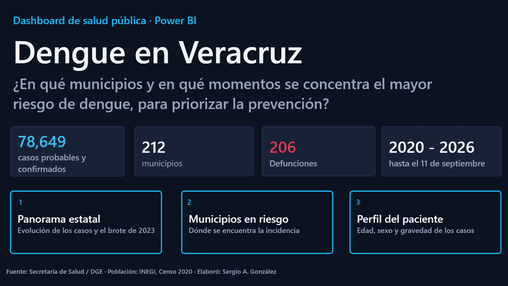
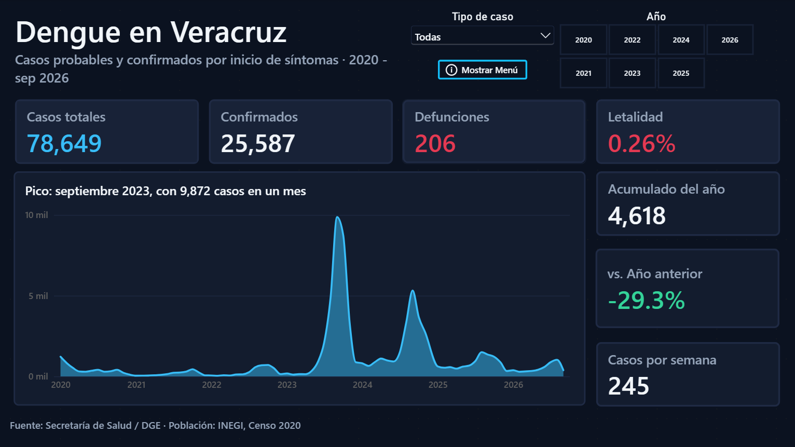
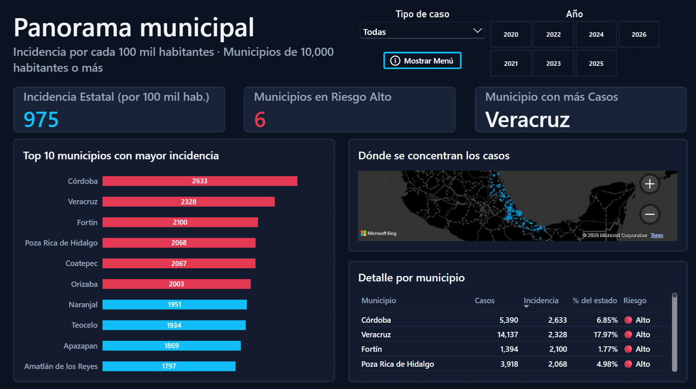
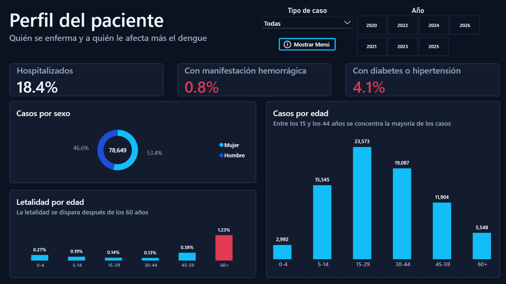

# Dengue en Veracruz (2020 – 2026)

Un dashboard en Power BI que usa datos abiertos de la Secretaría de Salud para ver cómo se ha comportado el dengue en Veracruz, qué municipios están peor y a quién le pega más.

Lo hice como proyecto de portafolio. Quería trabajar con datos reales, de un problema real, y pasar por todo el camino: bajar los archivos, meterlos a una base de datos, limpiarlos con SQL y armar el modelo y el reporte en Power BI.



## La pregunta que quería responder

> ¿En qué municipios y en qué momentos se concentra el mayor riesgo de dengue, para saber dónde conviene priorizar la prevención?

El dashboard tiene tres páginas, una por cada parte de la pregunta:

1. **Panorama estatal:** cómo han cambiado los casos mes a mes y cómo se ve el brote de 2023.
2. **Municipios en riesgo:** dónde hay más casos por cada 100 mil habitantes, con mapa, ranking y un semáforo de riesgo.
3. **Perfil del paciente:** edad, sexo y gravedad de los casos.





## Qué encontré

- **Son 78,649 casos** (probables y confirmados) entre enero de 2020 y el 11 de septiembre de 2026. De ahí, 25,587 están confirmados y hubo 206 defunciones (letalidad de 0.26%).
- **2023 fue el año del brote.** Septiembre de 2023 tuvo 9,872 casos en un solo mes, y ese año suma 31,738. En 2024 hubo otro pico más chico (21,929 casos en el año).
- **Lo que va de 2026 va mejor:** 4,618 casos hasta el 11 de septiembre, un 29.3% menos que en el mismo periodo de 2025.
- **Córdoba tiene la incidencia más alta** (2,633 casos por cada 100 mil habitantes), seguida de Veracruz (2,328), Fortín (2,100) y Poza Rica (2,068). El municipio de Veracruz es el que más casos suma: 14,137, casi 18% del total del estado.
- **La letalidad sube mucho después de los 60 años:** alrededor de 1.2%, contra menos de 0.4% en los otros grupos de edad.
- **Entre los 15 y los 44 años está más o menos la mitad de los casos**, y las mujeres son el 53% del total.

## De dónde salen los datos

| Qué | Fuente |
|---|---|
| Casos de dengue (un registro por caso) | Secretaría de Salud, Dirección General de Epidemiología. Datos abiertos, disponibles en datos.gob.mx |
| Significado de los códigos | Archivos "Catálogos" y "Descriptores" que vienen en la misma descarga |
| Población por municipio | INEGI, Censo de Población y Vivienda 2020 (ITER de Veracruz) |

Del archivo de dengue me quedé solo con los registros cuyo estado de residencia es Veracruz (clave 30): **108,801 registros**. De esos, 30,152 son casos descartados, así que no los cuento.

### Cómo leí los códigos

Los archivos vienen con números, no con palabras. Estos son los que más usé (están en las tablas `dim_` del modelo para poder consultarlos):

- **Estatus del caso:** 1 = Probable, 2 = Confirmado, 3 = Descartado
- **Sexo:** 1 = Mujer, 2 = Hombre
- **Tipo de paciente:** 1 = Ambulatorio, 2 = Hospitalizado
- **Sí / No** (defunción, diabetes, etc.): 1 = Sí, 2 = No

## Cómo lo armé

```
CSV de dengue + Excel de población
            |
            v
   MySQL (XAMPP)  -->  staging  -->  tablas limpias
            |
            v
   Power BI: modelo en estrella + medidas DAX
```

1. **Carga:** importé el CSV tal cual a una tabla de staging, con todo como texto, para que nada se rompiera por formatos raros.
2. **Limpieza en SQL:** pasé las fechas (venían como números de Excel), rellené con ceros las claves de municipio para poder cruzarlas con INEGI y convertí los códigos a tipos de dato correctos.
3. **Modelo:** una tabla de hechos (`fact_casos`) y varias dimensiones (municipio, fecha, estatus, sexo, etc.).
4. **Power BI:** conecté la base de datos, armé las relaciones y escribí las medidas en DAX.

Los scripts están en la carpeta [`sql/`](sql/).

## Medidas DAX que más uso

Estas son las más importantes. El resto de las medidas del reporte se construyen sobre ellas.

```dax
-- Cuento probables y confirmados, no descartados
Casos =
CALCULATE(COUNTROWS(fact_casos), fact_casos[estatus_caso] IN {1, 2})

Letalidad % =
DIVIDE([Defunciones], [Casos])

-- Para comparar municipios de distinto tamaño
Incidencia x 100k =
DIVIDE([Casos], SUM(dim_municipio[poblacion_2020])) * 100000

-- Semáforo: Alto si duplica la incidencia del estado
Nivel de Riesgo =
VAR inc = [Incidencia x 100k]
VAR est = [Incidencia Estatal]
RETURN
SWITCH(
    TRUE(),
    ISBLANK([Casos]), "Sin casos",
    inc >= 2 * est, "Alto",
    inc >= est, "Medio",
    "Bajo"
)

-- Casos de este año contra el mismo periodo del año anterior
Var YTD vs Año Previo =
VAR f = CALCULATE(MAX(dim_fecha[Date]), ALLSELECTED(dim_fecha))
VAR ini = DATE(YEAR(f), 1, 1)
VAR act = CALCULATE([Casos], REMOVEFILTERS(dim_fecha), DATESBETWEEN(dim_fecha[Date], ini, f))
VAR ant = CALCULATE([Casos], REMOVEFILTERS(dim_fecha), DATESBETWEEN(dim_fecha[Date], EDATE(ini, -12), EDATE(f, -12)))
RETURN DIVIDE(act - ant, ant)
```

## Decisiones que tomé (y por qué)

- **"Caso" = probable + confirmado.** Los descartados no cuentan. La columna `DICTAMEN` casi siempre dice "No aplica", así que para saber si un caso está confirmado me fui por el estatus del caso.
- **Las fechas son por inicio de síntomas**, no por fecha de registro.
- **La población es fija (Censo 2020)** para todos los años. Es una simplificación: la población real cambia, y las incidencias de 2024 a 2026 podrían ajustarse un poco con proyecciones de CONAPO.
- **En la página de municipios dejé fuera los de menos de 10,000 habitantes.** Con poblaciones muy chicas, un par de casos hace que la incidencia se dispare y confunde más de lo que ayuda.
- **El nivel de riesgo es relativo:** compara cada municipio contra el promedio del estado, no contra un umbral médico oficial.

## Cosas a tener en cuenta

- Las últimas semanas de datos pueden estar incompletas, porque los casos se registran con retraso.
- Los datos son de vigilancia epidemiológica, no un conteo perfecto de todos los casos que hubo en la realidad.
- Este proyecto es un ejercicio de análisis de datos. No sustituye ningún reporte oficial de Salud.

## Un detalle de uso

El menú de navegación aparece al presionar **Mostrar menú** y esconde el filtro de año mientras está abierto.
Ciérralo con **Ocultar menú** si quieres volver a cambiar de año.

## Qué tiene el repositorio

```
.
├── README.md
├── capturas/        imágenes de las páginas del dashboard
├── sql/             scripts: tablas, carga y limpieza
└── dashboard/       archivo .pbix
```

## Herramientas

MySQL (XAMPP y phpMyAdmin) · SQL · Power BI · DAX · Power Query

## Quién lo hizo

Sergio A. González, Ingeniero en Sistemas Computacionales, Veracruz.
LinkedIn: [linkedin.com/in/sergioagonzalez06](https://linkedin.com/in/sergioagonzalez06)
